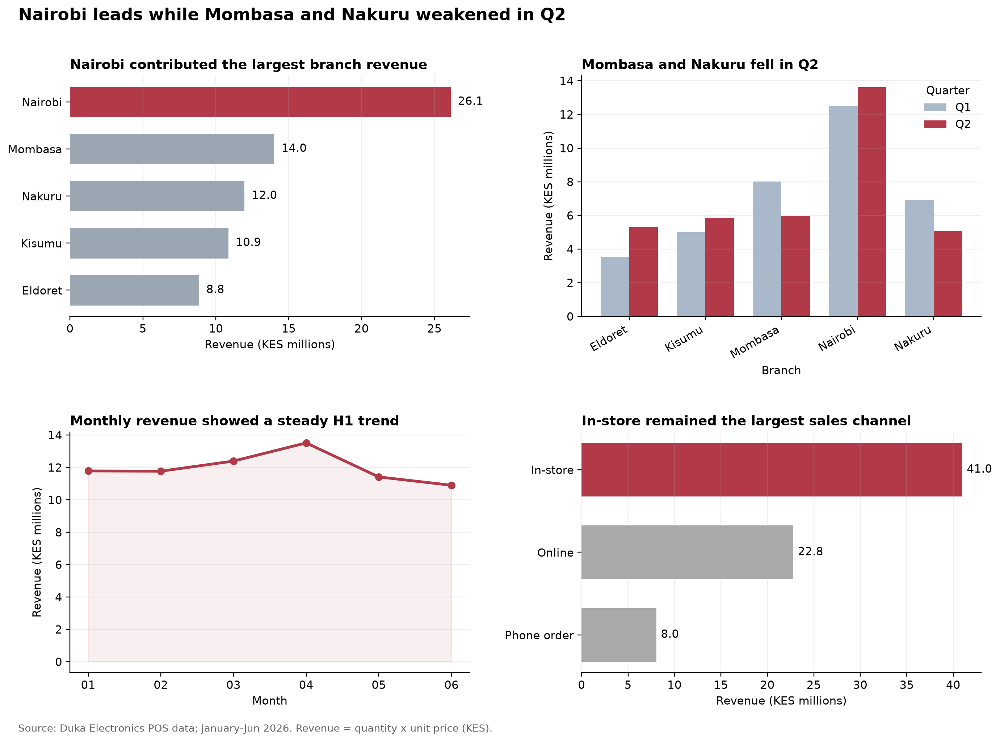

# PLP DA A4 – Student EDA and Board Report

## Repository Overview

This repository contains two analytics engagements demonstrating both exploratory data analysis (EDA) and executive data storytelling.

### Engagement 1: County Education Office

The objective was to analyse student-performance data from 1,200 learners and identify factors associated with higher academic achievement. The analysis focused on attendance patterns, study behaviour, school type, county differences and learner-risk segmentation.

### Engagement 2: Duka Electronics Board Report

The objective was to transform Duka Electronics H1 2026 sales data into a concise executive report and interactive dashboard suitable for non-technical board members. The report highlights performance trends, branch-level changes, sales channels and practical recommendations for H2 2026.

---

## How to Run the Project

### 1. Install Requirements

```bash
pip install -r requirements.txt
```

### 2. Generate the Datasets

```bash
python generate_data.py
```

This generates:

- `student_performance.csv`
- `duka_sales.csv`

### 3. Run the Analysis

Open and run the following notebooks from top to bottom:

- `student_eda.ipynb`
- `board_report.ipynb`

---

## Five Key EDA Insights

1. Attendance rate and study hours show strong positive relationships with academic performance.
2. Private-school learners consistently outperform public-school learners across attendance bands and study-hour quartiles.
3. County-level variation exists in the proportion of learners classified as At Risk.
4. Each additional weekly study hour is associated with approximately two additional marks on average.
5. Study behaviour explains only part of learner achievement, indicating the influence of factors not captured in the dataset.

---

## Board Summary (150 Words)

Duka Electronics recorded strong overall sales performance during the first half of 2026, driven primarily by Nairobi branch operations. However, branch-level analysis revealed that overall company growth concealed important regional differences. While Eldoret and Kisumu experienced positive momentum during the second quarter, Mombasa and Nakuru showed noticeable declines that may require management attention. Sales remained concentrated in a limited number of products and channels, creating opportunities to improve revenue through targeted marketing and inventory strategies. The board report recommends prioritising recovery initiatives in underperforming branches while maintaining support for areas demonstrating sustained growth. By combining operational support, promotional activity and close monitoring of branch performance, Duka Electronics can strengthen results during H2 2026. The accompanying Looker Studio dashboard provides an interactive view of branch, product and channel performance, helping decision makers explore trends and make evidence-based budgeting decisions.

---

## One-Page Board Report



---

## Dashboard

See `dashboard.md` for the public Looker Studio dashboard link and screenshots.
